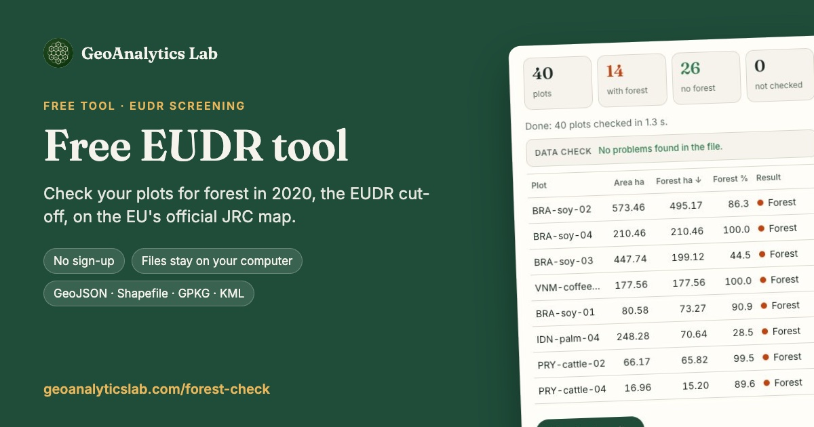

# EUDR Free Check

**Free, open-source deforestation screening for the EU Deforestation Regulation (EUDR), entirely in the browser.**

Drop a file with plot geolocations (GeoJSON, Shapefile, GeoPackage or KML) and see in seconds which plots had forest in 2020,
the EUDR cut-off year, according to the European Commission's **JRC Global Forest Cover 2020** map (version 4, 10 m).
Files never leave the user's computer: the browser reads only the parts of the forest map that overlap the plots.

**Live tool:** [geoanalyticslab.com/forest-check](https://geoanalyticslab.com/forest-check/) · also in
[Spanish](https://geoanalyticslab.com/es/forest-check/) and [Portuguese](https://geoanalyticslab.com/pt/forest-check/)



## Features

- **Formats:** GeoJSON, zipped Shapefile, GeoPackage (several layers), KML/KMZ, and any of these inside a ZIP.
  Any coordinate system the file declares (`.prj`, GeoPackage SRS, GeoJSON `crs`) is reprojected to WGS84.
- **Polygons and points.** Under the EUDR a single point is enough for plots under 4 ha.
- **Per plot:** area, forest area (ha), forest share (%) and a result: *Forest* / *No forest* / the reason a plot could not be checked.
- **Data check:** plain-language messages for damaged files and invalid geometries (self-intersections, holes outside the plot,
  empty or tiny polygons, lines, projected coordinates without a coordinate system, plots in the sea, swapped latitude/longitude).
- **Map:** plots on satellite imagery (Sentinel-2 cloudless, optionally Mapbox at field scale) with the JRC forest layer.
- **Downloads:** CSV + GeoJSON (results as attributes) in one ZIP; optional registration step before download.
- **Languages:** English, Spanish and Portuguese (`web/i18n.js`).
- **Private by design:** no upload, no server-side processing; only small byte ranges of public map tiles are requested.

## How it works

```
 user file ──► readers.js ──► checks + WGS84 plots ──► worker.js (Web Worker) ──► results table, map, ZIP
 (GeoJSON, SHP, GPKG, KML)                              │
                                                        ▼  HTTP range requests (geotiff.js)
                              JRC GFC2020 v4 as 10° Cloud-Optimized GeoTIFF tiles (tiles.json + *.tif)
```

1. **Reading** (`web/readers.js`): GeoJSON natively; Shapefile with [shpjs](https://github.com/calvinmetcalf/shapefile-js);
   GeoPackage with [sql.js](https://github.com/sql-js/sql.js) and a WKB parser; KML/KMZ with the browser's XML parser and
   [fflate](https://github.com/101arrowz/fflate); reprojection with [proj4js](https://github.com/proj4js/proj4js).
2. **Checks:** rings are cleaned, holes outside their plot ignored, self-intersections flagged, oversized plots (> 100,000 ha) refused.
3. **Analysis** (`web/worker.js`): plots are converted to one global pixel grid (1/12000°, origin −180°/80°). The worker fetches
   each 1024×1024 block of the tiles once with [geotiff.js](https://github.com/geotiffjs/geotiff.js) and counts forest pixels
   with a scanline fill: **a pixel counts when its centre lies inside the plot** (same rule as GDAL rasterize). Overlapping parts
   of multi-part plots are merged. Pixel areas are computed per row on the authalic sphere. Plots crossing tile edges are exact.
4. **Sea check:** plots without forest are tested against the Natural Earth 1:10m land and minor islands, extended at least
   ~100 m beyond the coast (`web/landmask.json`, loaded only when needed). A plot is flagged *In the sea?* only if it is more than
   ~1 km off that outline, which catches swapped coordinates without flagging coastal plots.

## Validation

`tools/make_test_datasets.py` creates 10 synthetic sourcing portfolios (about 2,400 plots in 21 commodity regions, every
supported format, projected coordinates, multi-layer files, tile corners and edge cases). `tools/reference_datasets.py` (set `TILES_BASE` to your tiles) computes
the same statistics with GDAL/rasterio from the same tiles, and `tools/compare_datasets.py` compares them with the browser results.

| | Result |
|---|---|
| Polygons with identical forest pixel count | 1,670 / 1,671 (the exception is a deliberately self-intersecting "bow-tie", flagged as approximate) |
| Points with identical result | 741 / 741 |
| Typical time, 250 plots, empty browser cache | 3–7 s |
| Coastal land points (within 10 km of the Brazilian coast) wrongly flagged as sea | 0 / 600 (`testdata/forest-check-coast/`) |

`tools/make_broken_datasets.py` creates 13 damaged or awkward files (truncated, wrong type, missing `.dbf`, UTM without `.prj`,
swapped coordinates, invalid geometries, oversized plots) to test the error messages; `tools/browser/drop.mjs` drops files on the
page in Chrome and prints what the page shows.

## Set up your own installation

The tool is a set of static files (`web/`) that any web server or static host can serve. It needs the forest map as 10° COG
tiles on storage you control (next section). Then set the values in `web/config.js`:

| Setting | Purpose |
|---|---|
| `TILES_MANIFEST` | URL of your `tiles.json` listing the 10° COG tiles (required) |
| `MAPBOX_TOKEN` | optional Mapbox public token for high-resolution imagery at field scale (empty = Sentinel-2 only) |
| `FORMS_URL` | optional registration endpoint before download (empty = direct download) |
| `TURNSTILE_SITEKEY` | optional Cloudflare Turnstile key for the registration form |

## Host the forest map tiles

The JRC publishes the map as one global 38 GB COG and as 10° tiles that are not cloud-optimized. `tools/build_tiles.py` cuts the
global COG into 10° COG tiles (DEFLATE, 1024 px blocks, no overviews, 15–300 MB each) and uploads them with
[rclone](https://rclone.org) to any S3-compatible storage, together with `tiles.json`:

```bash
pip install -r requirements.txt          # plus GDAL command-line tools and rclone
python3 tools/build_tiles.py             # all tiles in data/manifests/service_tiles.txt (resumable)
python3 tools/build_tiles.py S10_W60     # selected tiles
```

Edit `SOURCE` and `REMOTE` at the top of the script. `data/manifests/excluded_tiles.txt` lists tiles left out of the service
(everything north of 60° N, and Europe/Asia between 50° and 60° N); plots there are reported as *Outside coverage*.
The storage must allow CORS from your site and HTTP range requests. On Cloudflare R2, files under about 512 MB are edge-cached;
never overwrite a tile at the same URL (caches would keep the old bytes).

## Optional: registration before download

`worker-forms/` is a Cloudflare Worker that receives the registration (name, organization, email, consent, share of plots with and
without forest), validates the email (format, mail-receiving domain, no disposable address), stores a copy in Workers KV and emails
it through Cloudflare Email Routing. Copy `wrangler.example.toml` to `wrangler.toml`, fill in your values, edit `ALLOWED_ORIGINS`
in `src/index.js`, then `npx wrangler deploy`, and set `FORMS_URL` in `web/config.js`. Collecting personal data requires a privacy
notice; adapt the text in the registration dialog of `web/index.html`.

## Repository layout

```
web/                 the tool (static files: index.html, app.js, readers.js, worker.js, i18n.js, tool.css, base.css, config.js)
worker-forms/        optional registration endpoint (Cloudflare Worker)
tools/               tile builder, GDAL reference, test-data generators, comparison, browser tests (tools/browser)
data/manifests/      JRC tile list, excluded tiles, tiles in the service
testdata/            10 test portfolios, 13 broken files, zipped variants, coastal points
```

## Limitations

This is a **screening tool, not a compliance verdict.** The JRC map is not legally binding and has known errors, for example with
agroforestry. Forest in a plot in 2020 does not by itself mean non-compliance, and no forest in the map does not prove compliance.
The EUDR also requires legality information, risk assessment and mitigation (unless the country is classified as low risk), and a
due diligence statement in the EU Information System (TRACES).

## Data and credits

- Forest map: European Commission, Joint Research Centre, [Global Forest Cover 2020, version 4](https://forest-observatory.ec.europa.eu/).
- Basemap: [Sentinel-2 cloudless 2016](https://s2maps.eu) by EOX IT Services GmbH (contains modified Copernicus Sentinel data, CC BY 4.0);
  optionally © Mapbox © Maxar.
- Coastline: [Natural Earth](https://www.naturalearthdata.com/) 1:10m land and minor islands (public domain).
- Libraries: MapLibre GL JS, geotiff.js, shpjs, sql.js, proj4js, fflate.

## License

Apache License 2.0, see [LICENSE](LICENSE).

Made by [GeoAnalytics Lab](https://geoanalyticslab.com). For plot-level verification with high-resolution imagery and time series,
contact contact@geoanalyticslab.com.
